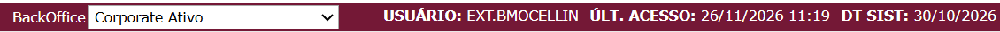

# Fluxos E2E no Sistema "Funções" (Legado)

Certos comandos devem ser executados via CMD na Máquina Virutal, outros podem ser executados em Tela diretamente no site.

---

Indice
## Índice

- [Inicializar Taxas](#-inicializar-taxas)
- [Inicialização do Sistema](#-inicialização-do-sistema)
- [Abertura de Proposta](#️-abertura-de-proposta) 
- [Consultar Proposta](#️-consultar-proposta)


📟 Terminal
🖥️ Web
👆 Click
📝 Form/Escrever
👀 Conferir
⚠️ Info
🚀 Abrir
⬇️ Dropdown
🌐 Página/Diretório
📦 Modal

---
## 🖥️ Inicializar Taxas

🌐 Home > 👆 Tabelas Corporativas
⬇️ Backoffice > 👆 Tabelas Web
⬇️ Operacional > 👆 Cotações > 👆 Incluir
🌐 Inclusão de Cotações:

- Cód. Indexador = 📝 11 (Nome Indexador = US$-V) > 👆 Confirmar

🌐 Cadastro de Cotações:

- 👀 Dt.Validade
- Taxa/Índice = 📝 [CotaçãoAtualDolarBacen] > 👆 Confirmar

⚠️ Inclusão realizada com sucesso! > 👆 Ok

Refazer até Conferir novamente:

- 👀 Dt.Validade [AgoraDataAtual]

> ⚠️ *Não necessarimente precisa ser cadastrada sempre. Se houver uma cadastrada para uma data futura, a mesma pode ser usada até a data descrita.*

### [↩️ Voltar](#índice)
---

# 📟 Inicialização do Sistema

Deve-se logar na máquina virtual **w19pnhhfcatc01**, com usuário e senha iguais de acesso ao Note do Banco Pine

Os **IDs** dos Sistemas são os seguintes:
|    ID    | Nome CMD                            | Nome Web              |
|----------|-------------------------------------|---------------------- |
|**009**	 | ATIVOS	 	 	 	 	 	                   | Corporate Ativo       |
|**015**	 | ATIVOS REPASSES BNDES	 	 	 	 	 	   | Repasse BNDES Ativo   |
| **016**	 | PASSIVOS BNDES REPASSES	 	 	 	 	 	 | Repasse BNDES Passivo |
| **017**	 | RES.2770 Ativo	 	 	 	 	 	           | Repasse ME Ativo      |
| **018**	 | RES.2770 Passivo	 	 	 	 	 	         | Repasse ME PassivoR   |
|* **038** | FUNCAFE ATIVO (fora da cobertura ?) | Funcafé Ativo         |

🚀 Conexão de Área de Trabalho Remota:

- Computador =  **w19pnhhfcatc01**
- user =  **userBancoPine**
- pass =  **passBancoPine**

🌐 D:\Sistemas\Funcao\LinhasDeComando\FI.Atacado.CMD
🚀 CMD
```bash
DEL FIERRO.TXT
FI.Atacado.CMD.exe INICIA CODBACK=IDs DTINICIA=DD/MM/YYY
```

**DEL FIERRO.TXT = Delete File Error txt**
Deleta arquivo prévio de erro anterior para permitir inicio correto do fluxo. O arquivo exisitindo impede o inicio.

**FI.Atacado.CMD.exe INICIA CODBACK=IDs DTINICIA=DD/MM/YYY**
É o executável que inicia o "Sistema", escolhido via ID e com a data em DTINICIA.

> ⚠️ *Inicialização do Sistema não avança sem ter uma "Taxa Iniciada"*
### [↩️ Voltar](#índice)

---

# 🖥️ Abertura de Proposta 

Ao voltar para Web para os próximos Steps, é possível conferir a data do Sistema Iniciado no Header.

🌐 Home > 👆 Web Corporate Contabil IFRS
🌐 > ⬇️ Backoffice > 👆 [Escolher o Sistema]



Voltando para Home, agora o procedimento para Abertura de Proposta

🌐 Home > 👆 Proposta
⬇️ Proposta > 👆 Cadastro de Proposta
🌐 Cadastro de Proposta > ⬇️ Produtos: > 👆 50 - CAPITAL GIRO > 👆 Confirmar
🌐 Dados Básicos da Proposta:
- 👆 Código do Cliente > 📦 Pesquisa > 👆 Pesquisar > 👆 51 LEVIAN PARTICIPACOES E EMPREEND.LTD
- 📝 Valor da Operação = 1.000.000,00 
- 👆 Confirmar
🌐 Condições da Operação:
  - ⬇️ Porte da Empresa > 👆 Média
  - ⬇️ Tipo de Cálculo (Conforme Tabela de Cálculo) > 👆 51 - Principais iguais jrs s/parcela
  - 📝 Data Base = Data da Inicialização do Sistema (Pegar no Header)
  - 📝 Qtd. Parc. = 12
  - 📝 Prz. 1ºVcto. = 32
  - ⬇️ Index./Moeda > 👆 01 - PREF
  - 👆 Confirmar
  - ⚠️ Atualize o fluxo de parcelas. > 👆 Ok
  - 👆 Fluxo de Parcelas

🌐 Fluxo de Parcelas > 👆 Confirmar
🌐 Condições da Operação > 👆 Confirmar
🌐 Número da Operação > Número da Operação = Proposta > 👆 Confirmar
🌐 Forma de Recebimento das Parcelas > 👆 Confirmar
🌐 Cadastro de Eventos > 👆 Confirmar
🌐 Liberação de Crédito > ⬇️ Cód. Banco/Agência/Conta > 👆 [Última Opção] > 👆 Incluir > 👆 Confirmar
🌐 Análise de Crédito > 👆 Aprova
⚠️ 3 - Proposta com data base futura. > 👆 Ok

### [↩️ Voltar](#índice)

---

# 🖥️ Consultar Proposta

🖥️ Web
👆 Click
📝 Form/Escrever
👀 Conferir
⚠️ Info
🚀 Abrir
⬇️ Dropdown
🌐 Página/Diretório
📦 Modal

### [↩️ Voltar](#índice)

---